<div align="center">

# 🔬 Deep Learning-Based Skin Cancer Classification<br>and Its Evaluation on Indian Skin Images

**Seven-class dermoscopic lesion classification with CNN and transformer ensembles,<br>
tested honestly on Indian clinical photographs.**


| 🏆 v2 accuracy | 🎯 v2 macro-F1 | ⚕️ Benign vs malignant | 📊 Report ensemble | 🇮🇳 False-cancer rate, Indian photos |
|:---:|:---:|:---:|:---:|:---:|
| **90.4 %** | **0.831** | **93.1 %** | **84.6 %** acc · 0.771 F1 | **12.2 % → 7.0 %** with two-stage gate |

*Design Project – Alliance University · Sanya Shrivastava, Subha Mondal, Diksha Baranwal, Sanghmitra Kushetty · Guide: Prof. Kusuma J*

</div>

> ⚠️ **Research and education only — not a medical device.** No result here should be used to diagnose anyone.

---

## 🧭 Overview

Skin cancer models are usually trained and tested on fair-skinned, dermoscopic European images. This project asks two questions:

1. **How accurate can we get on the standard benchmark?** We train six architectures on **HAM10000** (10,015 dermoscopic images, 7 classes), combine them into an ensemble, and build an improved **v2** pipeline that reaches **90.4 % accuracy**.
2. **What happens on Indian skin?** We run the models on **DermaCon-IN** (5,450 clinical photos of Indian patients, Fitzpatrick III–VI) and measure how often they raise **false cancer alarms**, and whether a two-stage design helps.

**Ground rules we kept throughout:**
- 🔒 Split by **lesion** (no lesion appears in two of train/val/test) and by **patient** on DermaCon-IN.
- 🚫 Every model, weight, threshold and setup was chosen on **validation data only**; the test set was never used to choose anything.
- 🎲 Supporting studies use **3 seeds**; results have **95 % confidence intervals** (lesion/patient bootstrap, Wilson).
- 📉 **Weak and negative results are reported as they are.**

---

## 📈 Results at a glance

| Model (HAM10000 test, 1,502 images) | Accuracy | Macro-F1 | Melanoma recall | Malignant sensitivity | Macro AUC |
|---|:---:|:---:|:---:|:---:|:---:|
| EfficientNet-B0 | 0.825 | 0.708 | 0.599 | 0.669 | 0.935 |
| ResNet-50 | 0.833 | 0.719 | 0.587 | 0.669 | 0.946 |
| DenseNet-121 | 0.803 | 0.680 | 0.653 | 0.721 | 0.945 |
| ConvNeXt-Tiny | 0.827 | 0.736 | 0.581 | 0.717 | 0.945 |
| Swin-T | 0.826 | 0.699 | 0.587 | 0.693 | 0.942 |
| **Weighted ensemble** (chosen on validation) | **0.846** | **0.771** | **0.635** | **0.741** | **0.966** |
| ⭐ **v2 ensemble** (EfficientNet-B4 + EfficientNetV2-S, 384 px) | **0.904** | **0.831** | 0.641 | — | **0.982** |

- Report ensemble 95 % CI: accuracy **82.3–87.0 %**, macro-F1 **0.721–0.816**.
- v2 95 % CI: accuracy **88.3–92.3 %**.
- v2 benign-vs-malignant accuracy is **93.1 %** (sensitivity 76.6 %, specificity 97.1 %). With the screening threshold (0.14), sensitivity rises to **95.2 %** at specificity 83.3 %.

<p align="center">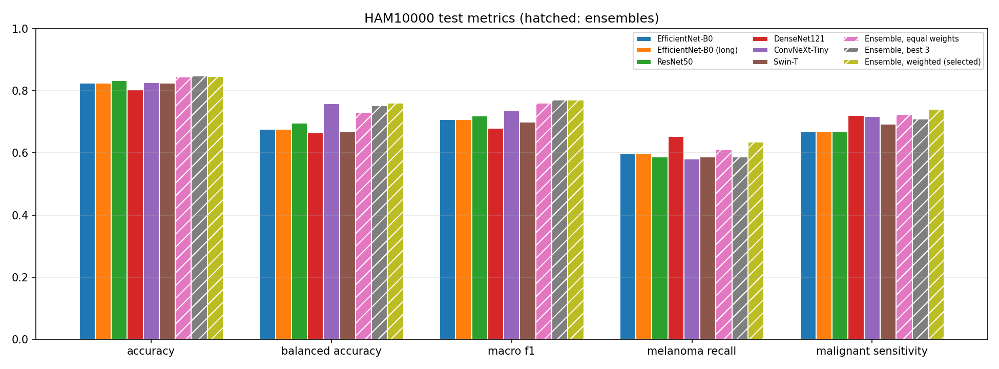</p>

---

## ⚙️ Pipeline

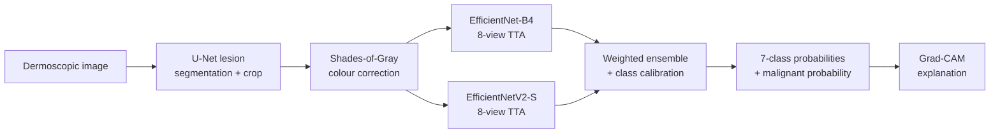

---

## 1️⃣ Six models + a validation-chosen ensemble (HAM10000)

- **Architectures:** EfficientNet-B0 (+ a longer run), ResNet-50, DenseNet-121, ConvNeXt-Tiny, Swin-T, all ImageNet-pretrained, at 224 px.
- **Training:** data augmentation, square-root class weights; the best epoch is chosen by validation macro-F1.
- **Ensembles:** equal weights, best three, and weights optimised on validation. **The weighted ensemble had the best validation macro-F1 (0.755) and was selected.** On test it is also best on macro-F1 and melanoma recall.
- **Honest weak spot:** melanoma. The ensemble still calls **35.9 %** of test melanomas benign, mostly confusing them with nevi.

| Confusion matrix | ROC curves | Grad-CAM |
|:---:|:---:|:---:|
| 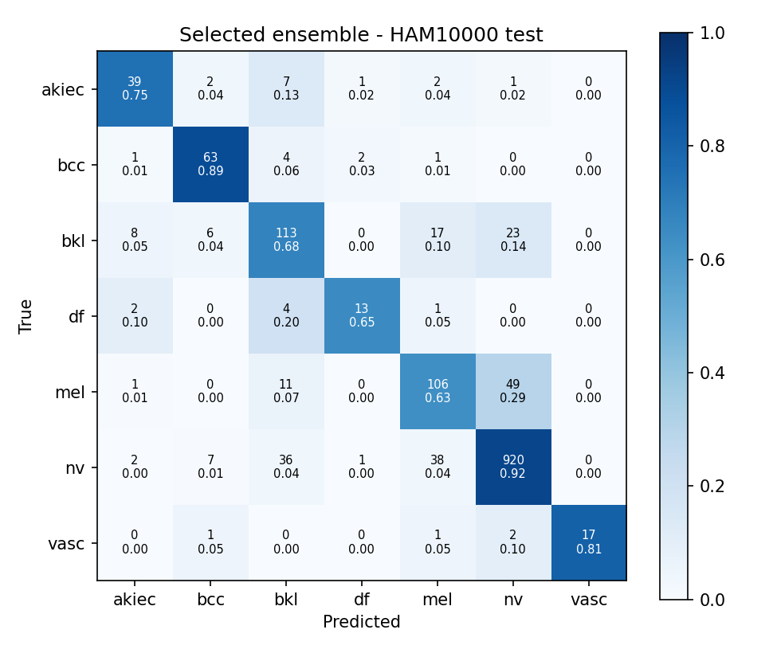 | 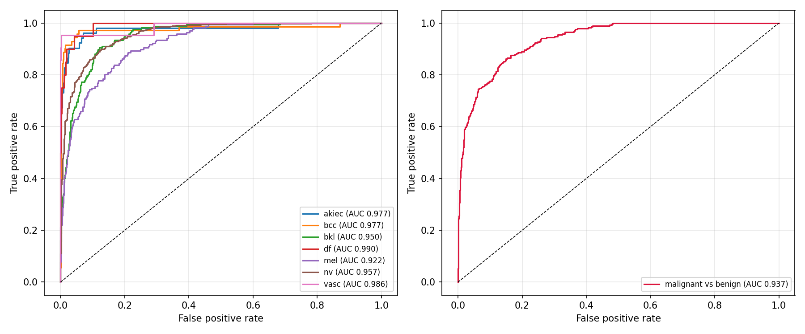 | 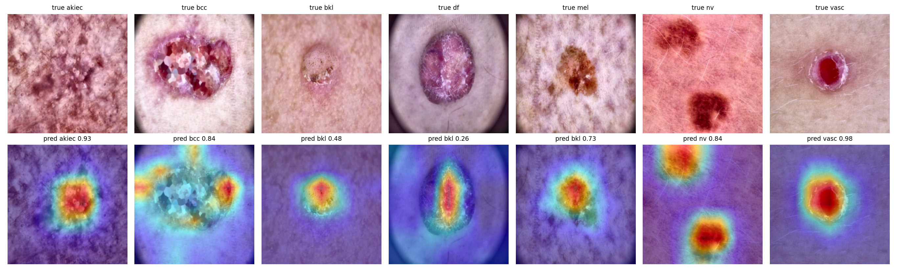 |

## 2️⃣ v2: the high-accuracy pipeline

| Step | What it does |
|---|---|
| 📚 More data | Trains on **ISIC 2019** (~25k images), tests on the same HAM10000 test split |
| ✂️ U-Net crop | EfficientNet-B4 U-Net (ISIC 2018 masks) crops each image to the lesion |
| 🎨 Colour constancy | Shades-of-Gray normalises lighting differences |
| 🔍 Higher resolution | 384 × 384 px input, with patient metadata (age, sex, body site) |
| 🔄 Test-time augmentation | 8 views per image (flips × 90° rotations), averaged |
| 🤝 Ensemble | EfficientNet-B4 (0.55) + EfficientNetV2-S (0.45), weights and class bias fitted on validation |

| Class | Precision | Recall | F1 | Test images |
|---|:---:|:---:|:---:|:---:|
| akiec – actinic keratosis | 0.667 | 0.692 | 0.679 | 52 |
| bcc – basal cell carcinoma | 0.854 | 0.986 | 0.915 | 71 |
| bkl – benign keratosis | 0.871 | 0.767 | 0.815 | 167 |
| df – dermatofibroma | 0.933 | 0.700 | 0.800 | 20 |
| mel – melanoma | 0.843 | 0.641 | 0.728 | 167 |
| nv – nevus | 0.930 | 0.979 | 0.954 | 1004 |
| vasc – vascular lesion | 0.950 | 0.905 | 0.927 | 21 |
| **Overall** | | | **macro 0.831** | **acc 0.904** |

<p align="center">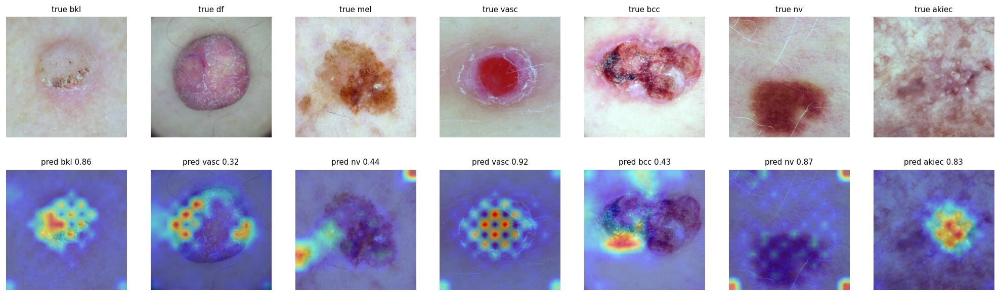</p>

## 3️⃣ Supporting studies (3 seeds each)

| Study | Finding |
|---|---|
| ⚖️ **Class imbalance** (none, √ weights, inverse, focal, sampler) | The validation rule chose **focal loss**. On test, the weighted sampler had the best macro-F1 (0.689) and melanoma recall (0.703), but all intervals overlap. |
| 🎨 **Skin-tone augmentation** | **Did not help.** Melanoma recall fell by **−0.094** [−0.148, −0.038]. |
| ✂️ **U-Net segmentation** | Dice **0.949 ± 0.001** vs **0.691** for Otsu thresholding |
| 🔍 **Training on lesion crops** | Macro-F1 **+0.049**, melanoma recall **+0.160**, malignant sensitivity **+0.108**, specificity −0.029 (all CIs exclude 0) |
| 🌫️ **Robustness** (blur, brightness, JPEG) | Ensemble macro-F1 falls from 0.771 (clean) to 0.57–0.61 averaged over 5 severities; all models degrade. |
| 🧠 **Grad-CAM faithfulness** | Deleting the highlighted pixels hurts the models more than deleting random pixels, so the maps point at real evidence. |

| Imbalance | Lesion masks & crops | Robustness |
|:---:|:---:|:---:|
| 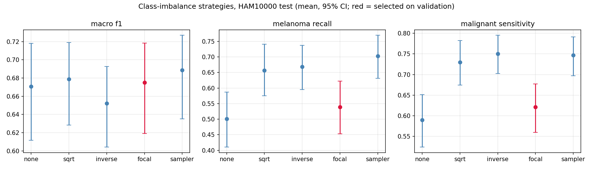 | 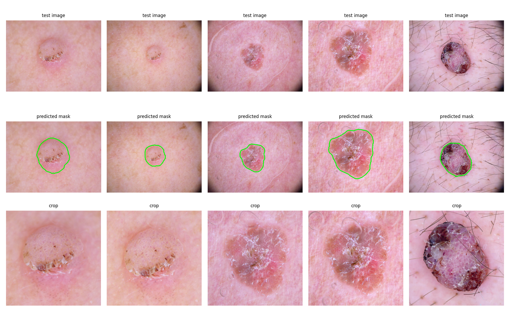 | 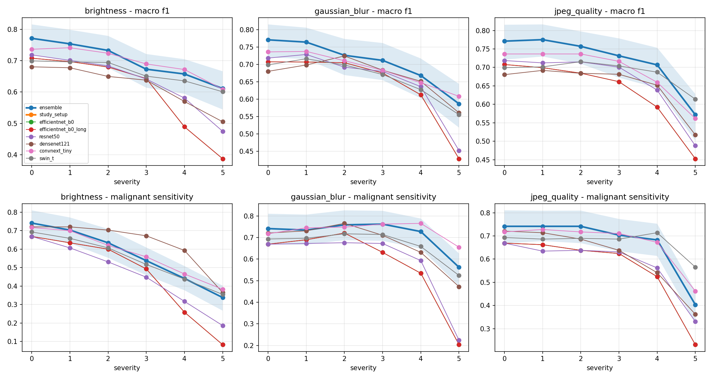 |

## 4️⃣ Indian skin (DermaCon-IN)

DermaCon-IN has **5,450** clinical photos from Indian patients. Only **52** are tumours; most are infections, inflammation and pigmentary disorders. The key safety question is: *how often does a HAM10000 model call a harmless Indian skin condition cancer?*

| Setup | False-cancer rate on 817 non-tumour test images |
|---|:---:|
| HAM10000 ensemble, zero-shot | **12.2 %** [10.2–14.7] |
| ➕ Stage-1 neoplasm gate (trained on Indian data, 3 seeds) | **7.0 % ± 1.1** (−5.3 points [−6.7, −4.1]) |
| Skin-tone-augmented model | 16.3 % (worse) |

- Rates are similar across Fitzpatrick III–IV vs V–VI and Monk skin tones. Acne, eczema and pigmentary disorders trigger the most false alarms.
- **Darker-skin cancer detection (DDI dataset) was not evaluated** and stays pending.

| False alarms by disease group | Two-stage vs ensemble |
|:---:|:---:|
| 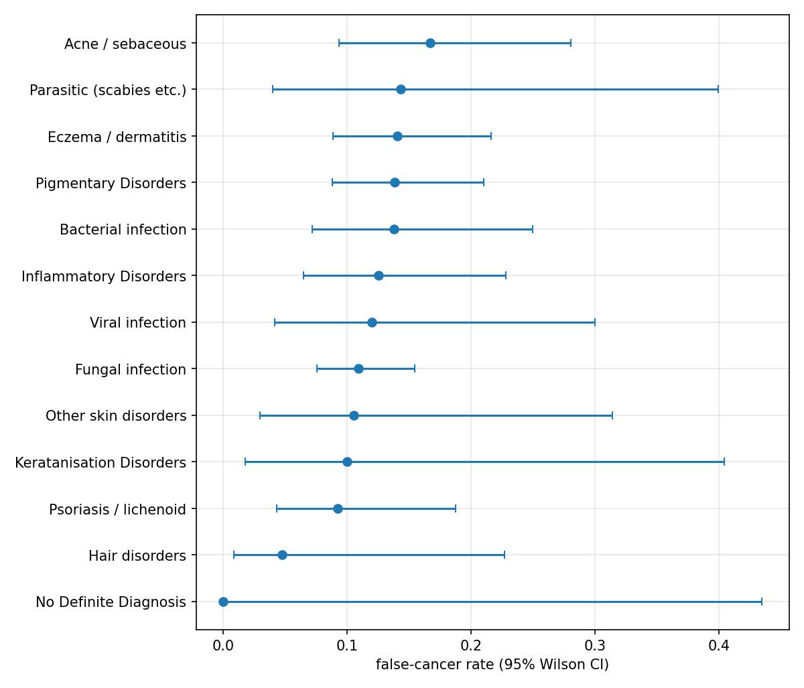 | 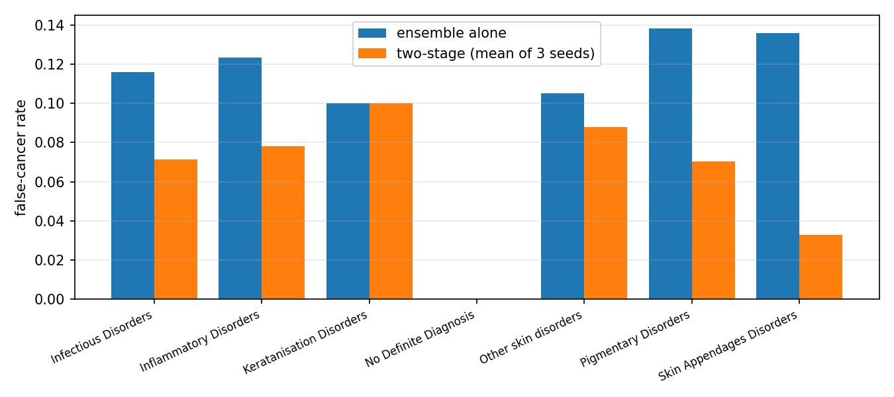 |

---

## 🖥️ Web app

`app_v3.py` is a Streamlit app that runs on a laptop CPU.

- **Three model choices:** v2 ensemble, report ensemble, and two-stage (gate + ensemble) for clinical photos.
- **Each prediction shows:** the original, cropped and colour-corrected image, the Grad-CAM heatmap, 7-class probabilities and the malignant probability.
- **Adjustable malignant threshold,** with an explanation of the sensitivity/specificity trade-off.
- **Step-by-step panel** explaining what v2 did to the image.
- **Downloadable PDF and CSV report.**

<p align="center">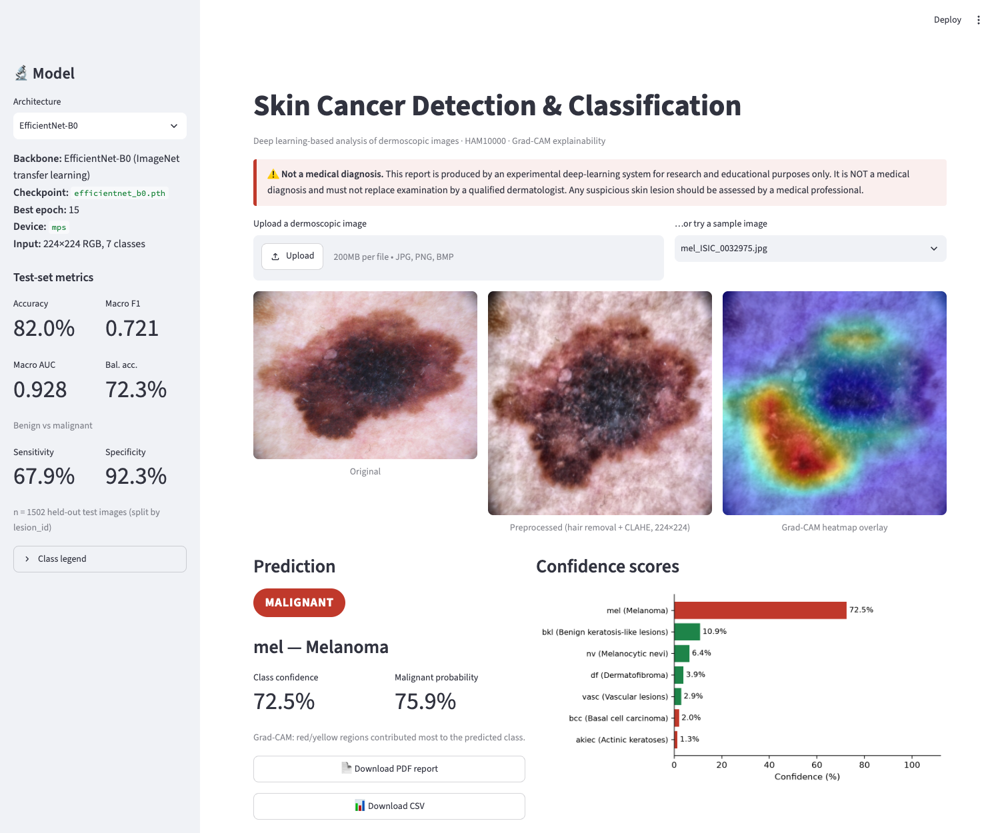<br><sub>First version of the app (single model). <code>app_v3.py</code> adds the ensembles, v2, the two-stage gate and the explanations.</sub></p>

---

## 🚀 Run it yourself

**1. Clone (with the trained models)**
```bash
git lfs install
git clone https://github.com/sanya1506/Deep-Learning-Based-Skin-Cancer-Detection-and-classification-using-dermoscopic-image-analysis.git
cd Deep-Learning-Based-Skin-Cancer-Detection-and-classification-using-dermoscopic-image-analysis
```

**2. Start the app**
```bash
python -m venv .venv
.venv\Scripts\activate          # Windows  (Linux/macOS: source .venv/bin/activate)
pip install -r requirements.txt -r improved/requirements-v2.txt
streamlit run app_v3.py         # then open http://localhost:8501
```

**3. Re-train everything (optional, free Kaggle GPU)**

The three self-contained notebooks in `notebooks/kaggle/` reproduce every number. Set Accelerator to **GPU T4** and Internet to **On**, run once with `SMOKE = True` as a quick check, then run with `SMOKE = False`.

| Notebook | Contents | Time (T4) |
|---|---|---|
| Part A | six HAM10000 models + ensembles | ~3 h |
| Part B | imbalance, skin-tone, U-Net + crop studies | ~5 h |
| Part C | robustness, Grad-CAM quality, DermaCon-IN, gate, sanity checks | ~1–2 h |
| `notebooks/20_improved_pipeline_v2.ipynb` | v2 pipeline | — |

Unzip each `part_*_outputs.zip` into the repo folder. Every number then lands in `results/study/report_numbers.json`, and `notebooks/19_sanity_checks.ipynb` re-checks the splits and selections.

---

## 📁 Repository layout

```
├── app_v3.py              Streamlit app (v2, ensemble, two-stage)
├── src/                   data, training, evaluation, statistics, Grad-CAM, studies, sanity checks
├── improved/              v2 pipeline (segmentation, training, ensemble, inference)
├── notebooks/             01–20 step-by-step notebooks + kaggle/ (Parts A, B, C)
├── models/                trained weights (.pth via Git LFS) – v2 in models/v2/
├── results/               tables, figures, predictions; study/ = everything in the report
├── data/splits/           lesion-level HAM10000 train/val/test split
├── deliverables/          final project report and conference paper (docx + pdf)
├── kaggle_runs/           run log (DECISIONS.md), report/paper build scripts
└── docs/                  earlier report, presentation, screenshots
```

**Not included:** DermaCon-IN per-image files and the gate models trained on it, because the dataset is research-use only. Re-run Part C with your own copy of DermaCon-IN to recreate them.

---

## 📚 Data & credits

- **HAM10000:** Tschandl et al., 2018 (CC BY-NC 4.0). The sample images in `sample_images/` come from it.
- **ISIC 2019 / ISIC 2018:** International Skin Imaging Collaboration.
- **DermaCon-IN:** Madarkar et al., 2025, research-use dataset of Indian clinical skin images (not redistributed here).
- Built with PyTorch, timm, segmentation-models-pytorch and Streamlit. Trained on Kaggle T4 GPUs.

<div align="center"><sub>Made by the Design Project 13 team, Alliance University · For research and education only</sub></div>
